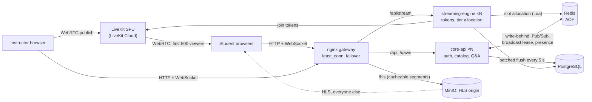

# OpenLecture

Live lectures for thousands of students at once: one instructor streams video,
students watch with sub-second or few-second delay depending on their tier,
and everyone asks and upvotes questions in real time.

It began as a university software-engineering project (Team 43; the course
deliverables are in [`docs/course/`](docs/course/)). It was then taken further
as an engineering exercise: load-test it, find what breaks, fix it, and measure
the fix. Every number below was measured on the code in this repo, and
[`docs/results.md`](docs/results.md) has the exact command, setup and raw output
for each.

## Architecture



Two Node.js services behind nginx, sharing Redis and one PostgreSQL. This is a
service split, not independent microservices: both read the same database.

## Key design decisions

| Decision | Why | Trade-off |
|---|---|---|
| **Two delivery tiers** (ADR-001): first 500 viewers on WebRTC, the rest on HLS | SFU capacity is the expensive part. HLS segments are immutable files a CDN can cache, so origin egress stays ~0.7 % of viewer egress ([capacity](docs/capacity.md)) | HLS viewers are 2–3 s behind instead of < 1 s |
| **WebRTC slots claimed atomically** in a Redis Lua script | The old check-then-act on the SFU's participant count let a burst blow past the cap | One Redis round trip per join. Stale slots are reconciled with LiveKit only when full |
| **Q&A write-behind**: Redis first, Postgres in 5 s batches | Votes stay off the database's critical path. Postgres sees one transaction per lecture per 5 s, not one per vote | A vote lives only in Redis (AOF, ≤ 1 s loss window) for up to 5 s |
| **Coalesced broadcasts** via a per-lecture Redis lease and version counter | Every vote used to send the full list to every viewer, so messages grew with votes × viewers. Now there are ≤ 4 updates/s per lecture across all instances, and the last update is never dropped (increment-and-acquire is one atomic script) | Updates can wait up to one 250 ms window under steady voting |
| **Bounded payload** (top 50 + counts) from Redis sorted sets, one per ranking strategy | Update size stopped growing with the lecture; no full re-sort per update | Clients see the top 50 open questions. The full list is available over REST |
| **Crash-safe presence**: per-instance socket counts + heartbeats + a sweeper | A killed instance used to leave the lecture looking occupied forever, so its last writes never reached Postgres | Cleanup after a crash waits for the 15 s heartbeat to expire |
| **One-time WebSocket tickets** (30 s, single-use `GETDEL`) | The JWT used to sit in the WebSocket URL; nginx had logged it 8,060 times | One extra HTTP request per (re)connect, median 2.5 ms |

## Measured results

All on one laptop: Docker Desktop, 14 vCPUs, load generator on the same machine,
3 × core-api, 3 × streaming-engine. Details and raw data in [`docs/results.md`](docs/results.md).

| What | Before | After |
|---|---|---|
| Q&A messages per viewer per second at 200 viewers, 21 votes/s | 21.4 | **4.05** (flat at ~4 up to 107 votes/s) |
| Q&A bytes per viewer per second, 200 viewers | 396 KB | **49 KB** |
| Q&A at 500 / 1000 viewers | not sustainable: 433 MB/s egress at 500, the test host ran out of memory | **1000 viewers: 54 KB/s each, p95 update latency 259 ms, 0 errors** |
| Update size in a 1,000-question lecture | 270 KB | **13.7 KB** |
| ACKed Q&A writes surviving a killed core-api, everyone leaving right after | **0 of 120** reached Postgres | **110 of 110** |
| Same, under 1000-viewer load (332 sockets dropped) | 14,586 of 14,586 kept, Redis buffer leaked | 14,179 of 14,179 kept, all 332 reconnected within 1.0 s, buffer cleaned |
| Redis restart after SIGKILL, 10,000 writes | 0 kept (no AOF) | **10,000 kept** |
| PostgreSQL CPU at 1000 viewers (flush) | 14 % | **1.2 %** |
| 1,000 simultaneous joins, WebRTC limit 500 | – | **exactly 500 WebRTC + 500 HLS**, 0 failures |
| Join latency with the enrollment check added | median 3.52 ms | median 3.58 ms (p95 10.7 ms) |

In the "under load" row the old code also kept every write, because that workload
stops voting 5 s before clients leave. The row above it isolates the case it got wrong.

## Capacity: 10,000 viewers in one lecture

Estimated from the measured unit costs above; [`docs/capacity.md`](docs/capacity.md)
shows every assumption and calculation.

| Component | Estimate |
|---|---|
| Video | 15 Gbps to viewers. SFU 1–2 nodes for the 500 WebRTC viewers; HLS origin ~106 Mbps behind a CDN |
| core-api | 7–8 instances (≈ 3,000 Q&A sockets per core at 4 updates/s) |
| Redis | ≈ 9 % of one core at 1,000 votes/s; ≈ 3.4 MB per large lecture |
| PostgreSQL | ≈ 1,000 rows/s in 0.2 transactions/s per lecture |
| **Q&A egress** | **≈ 4.4 Gbps, about 30 % of the video bandwidth.** The next thing to fix: e.g. 1 update/s for HLS viewers → ≈ 1.2 Gbps |

## What is real and what is simulated

- **Real:** auth, enrollment and access control, the Q&A system end to end,
  WebRTC tier allocation, nginx load balancing and failover, Redis/Postgres
  durability, metrics. All of it is load-tested and failure-tested as above.
- **Delegated:** the SFU is **LiveKit Cloud** (free tier), not self-hosted.
- **Simulated:** the HLS tier plays **Apple's public test stream**. LiveKit's
  free tier has no egress, so no lecture is actually transcoded to HLS, and
  MinIO and the nginx HLS cache rules have no real segments to serve. No CDN.
- **Single host:** every measurement is from one laptop, with the load generator
  competing for the same CPUs. Per-core numbers are order-of-magnitude.
- **Single points of failure:** one Redis, one PostgreSQL, one nginx, with no
  replicas or failover. AOF protects Redis data across a restart, not its availability.
- **Course ADRs vs code:** ADR-003 proposes Kafka. The implementation uses Redis
  Pub/Sub instead.
- **Frontend:** builds, but the latest Q&A/reconnect/ticket changes were verified
  through scripted clients, not in a browser.

## Run it

Windows / PowerShell with Docker Desktop, from `globalclass/`:

```powershell
Copy-Item .env.example .env          # add LiveKit Cloud keys (needed to start a stream)
docker compose up -d --build --scale core-api=3 --scale streaming-engine=3
docker compose restart api-gateway   # nginx resolves upstream IPs only at startup
cd frontend; npm install; npm start  # http://localhost:3000
```

Checks and load tests:

```powershell
cd backend; node scripts/smoke.js; node scripts/access-check.js; cd ..
.\scripts\run-qa-load.ps1 -Clients 1000 -Tag mytest        # Q&A WebSocket load, results in docs/raw/
.\scripts\chaos-kill-core.ps1 -Clients 1000 -Tag mychaos   # same, killing one core-api mid-run
docker compose --profile observability up -d               # Prometheus :9090, Grafana :3001
```

[`globalclass/README.md`](globalclass/README.md) has the API, the WebSocket protocol and
the full list of test scripts.

## Repository

```
globalclass/   the implementation (services, nginx, compose, load tests, scripts)
docs/          results.md (measurements), capacity.md (sizing), raw/ (raw run output)
docs/course/   the original course deliverables: report, proposal, ADRs, diagrams
```
